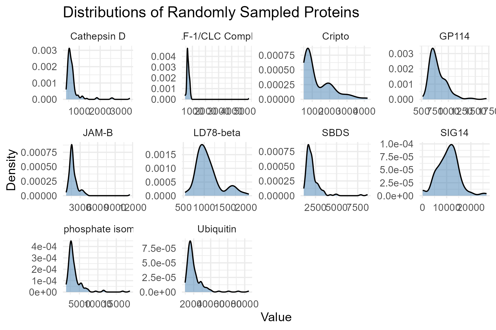
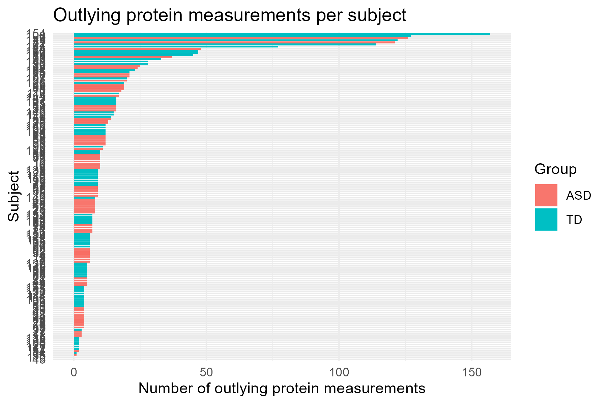

From the 10 proteins we sampled, it seems that many of the proteins in the sample are heavily right-skewed. This implies that most of the participants in the study have protein counts for these proteins in the very low end of the study's range of protein counts.



A log transformation helps normalize these protein values so that the data looks more bell-shaped. Normalizing the data allows us to apply statistical and machine learning methods that rely on the data being roughly normal.

After, we checked to see how many outliers each subject had. Below is a table sorted by how many outliers each subject had.

```{r, echo = F, warning = F, error = F, message = F}
library(tidyverse)
library(kableExtra)

# get names
var_names <- read_csv('../data/biomarker-raw.csv', 
                      col_names = F, 
                      n_max = 2, 
                      col_select = -(1:2)) %>%
  t() %>%
  as_tibble() %>%
  rename(name = V1, 
         abbreviation = V2) %>%
  na.omit()

# read in data
biomarker_clean <- read_csv('../data/biomarker-raw.csv', 
                            skip = 2,
                            col_select = -2L,
                            col_names = c('group', 
                                          'empty',
                                          pull(var_names, abbreviation),
                                          'ados'),
                            na = c('-', '')) %>%
  filter(!is.na(group)) %>%
  # Create subject_id column to keep track of each subject
  mutate(subject_id = row_number()) %>%
  # Log transform, center, and scale, but do not trim
  mutate(across(
    -c(subject_id, group, ados),
    ~ scale(log10(.x))[, 1]
  )) |> 
  select(subject_id, group, ados, everything())

# Pivot proteins into long format
protein_long <- biomarker_clean |> 
  pivot_longer(
    cols = -c(subject_id, group, ados),
    names_to = "protein",
    values_to = "z_score"
  ) |> 
  # New column to determine if value is outlier
  mutate(is_outlier = abs(z_score) > 3)

# Count how many outliers occur for each observation, proportions
subject_outliers <- protein_long |> 
  group_by(subject_id, group) |> 
  summarise(
    n_measured = sum(!is.na(z_score)),
    n_outliers = sum(is_outlier, na.rm = TRUE),
    .groups = "drop"
  ) |> 
  mutate(
    prop_outliers = if_else(
      n_measured > 0,
      n_outliers / n_measured,
      NA_real_
    )
  ) |> 
  arrange(desc(n_outliers))

# Subjects with the most outlying protein measurements
head(subject_outliers, 30) |> 
  kable()
```

As for outliers, there are six total subjects that have 100 or more outlier values out of the 1,317 proteins measured, with the counts of outlier values per subject falling rapidly below 50 after those six. Subject 154 had the most with 157 outliers, but was typically developing. This subject was also the only one who had outlier values in over 10% of the proteins measured.

```{r, echo = F, warning = F, error = F, message = F}
# Short summary of the groups' outlier counts
subject_outliers |> 
  group_by(group) |> 
  summarise(
    n_subjects = n(),
    mean_outliers = mean(n_outliers),
    median_outliers = median(n_outliers),
    max_outliers = max(n_outliers),
    pct_subjects_with_outliers = 100 * mean(n_outliers > 0),
    pct_measurements_outlying =
      100 * sum(n_outliers) / sum(n_measured),
    .groups = "drop"
  ) |> 
  kable()
```

Aggregating by groups, it appears that there's actually more eveidence that there's less outliers in the ASD group. This goes against intuition as we would not expect outlier values to be associated with identifying typically developing children. This might be due to small sample size or the nature of outlier values skewing the ASD group's mean count of outliers, while the median is the same. The percentage of subjects with outlier values is the same and the percentage of measurements with outlier values is not significantly different. We can visualize the lack of relation with the plot below:



Each bar is a subject and the x-axis is the number of outlying protein measurements for that subject, sorted by most to least outliers. There does not seem to be a clean way to divide the ASD and TD group purely by how many outlier values they have.