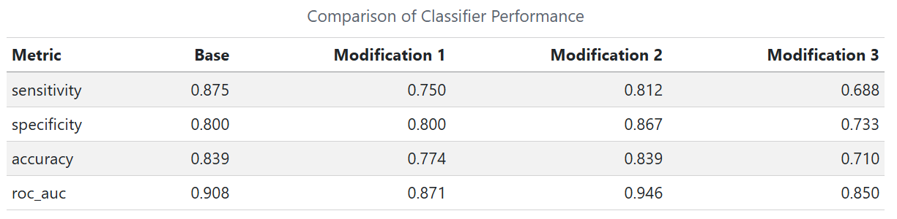

Use this as a template. Keep the headers and remove all other text. In all, your report can be quite short. When it is complete, render and then push changes to your team repository.

```{r}
# load any other packages and read data here
library(tidyverse)
```

## Abstract

This report builds on an in-class reproduction of Hewitson et al.'s (2021) serum protein biomarker panel for ASD to assess how sensitive the results are to specific methodological choices. We examine why the protein levels were log-transformed, check whether outliers are concentrated in particular subjects or in one diagnostic group, and modify the selection procedure in three ways, holding out test data before any selection, choosing more than ten top proteins per method, and using a fuzzy rather than hard intersection across methods, to compare to the in-class analysis. We then search for a simpler or alternative panel that achieves improved classification accuracy.

## Dataset

The data comes from Hewitson et al. (2021), a serum proteomic study of autism spectrum disorder (ASD). Fasting blood was drawn from 154 boys aged 18 months to 8 years: 76 with ASD and 78 typically developing (TD) controls. The mean age was about 5.6 years in the ASD group and 5.7 in the TD group. ASD diagnosis was based on DSM-5 criteria using the ADOS and ADI-R. TD boys were screened for developmental concerns with the ABAS-II, and boys with a family history of ASD were excluded. The raw data file has 154 rows (one per subject) and 1,317 protein columns. Each protein column has a full name and an abbreviation. The file also has a Group label (ASD or TD) and the ADOS total score (Social Affect + Restricted and Repetitive Behaviors). ADOS is recorded only for ASD subjects and is missing (“-”) for TD subjects.

For preprocessing, we read the protein names and abbreviations from the two header rows and recodes “-” and blank cells as missing. Empty rows were dropped, and a log10 transform was applied to each protein. Each protein is then z-scored across subjects, and values beyond ±3 are clipped to ±3 to limit outliers, and the cleaned data is saved as 'biomarker-clean.RData.'

## Summary of published analysis

The original paper, Hewitson et al. (2021), investigated whether blood protein levels could be used to distinguish children with autism spectrum disorder (ASD) from typically developing (TD) children. The goal was to create a panel of proteins that could be useful as blood biomarkers for detection of ASD. The study collected serum samples from 154 boys, 76 with ASD and 78 TD, all within 18 months to 8 years of age. With SOMAScan proteomic assay, researchers measured 1,317 proteins, of which 1,125 passed quality control. After data collection, the protein measurements were log-transformed and standardized before analysis.

Three feature selection methods were applied: random forest, t-tests, and correlation analysis. From these three methods, the researchers selected the top 10 proteins from each, and identified five proteins that were common to all three methods. The five proteins formed the base of the biomarker panel. Additional proteins were evaluated to be added to the panel based on their ability to improve the classifier's performance, resulting in a bigger panel of 9 proteins. The nine selected proteins were IgD, suPAR, MAPK14, EPHB2, DERM, ROR1, GI24, eIF-4H, and ARSB. Then, a logistic regression classifier was trained using 80% of the observations, with the remaining 20% forming the test set. The researchers evaluated the trained model using the area under the ROC curve (AUC) calculated on the test set. This procedure was repeated 1,000 times to reduce the effect of random variable from the training-testing split. The final nine protein logistic regression classifier model achieved a reported AUC of 0.8599, 83% sensitivity, and 84% specificity, but the study was later retracted due to issues in the statistical analysis.

```{mermaid}
flowchart TD
    A["154 serum samples<br/>76 ASD / 78 TD"]
    B["SOMAScan assay<br/>(1,317 proteins)"]
    C["Quality control and normalization<br/>(1,125 proteins retained)"]
    D["Random forest<br/>(Top 10)"]
    E["T-tests<br/>(Top 10)"]
    F["Correlation with ADOS<br/>(Top 10)"]
    G["Core panel: 5 proteins"]
    H["Evaluate additional proteins"]
    I["Final panel: 9 proteins"]
    J["Logistic regression classifier"]
    K["80% training / 20% testing<br/>1,000 repetitions"]
    L["Reported metrics:<br/>AUC ≈ 0.86<br/>Sensitivity ≈ 83%<br/>Specificity ≈ 84%"]

    A --> B --> C
    C --> D
    C --> E
    C --> F
    D --> G
    E --> G
    F --> G
    G --> H --> I --> J --> K --> L

```

## Findings

Summarize your findings here. I've included some subheaders in a way that seems natural to me; you can structure this section however you like.

### Impact of preprocessing and outliers

Tasks 1-2

### Methodological variations

In part three, we tested the base analysis alongside various modifications and then compared the models' performances. Here is a table that summarizes the evaluation metrics.



For modification 1, the training-testing split was done at the very start, before the feature selection, whereas in the original it was done at the start of the logistic regression. The sensitivity, accuracy, and roc_auc from the first modification are all lower than the original metrics. However, this does not mean that our model performance worsened after the modification. Instead, the initial analysis likely had data leakage, leading it to overestimate the model performance. By doing the training/testing split before any of the analysis, we do the feature extraction steps with only the training data, making the metrics after modification a better representation of our actual model performance.

For modification 2, the number of proteins selected from both feature selection methods was changed from 10 to 25. From the results, the classification performance showed mixed changes for this modification. Sensitivity decreased, accuracy remained the same, and specificity and roc_auc increased. This suggests that the modified model is a bit less sensitive to ASD but a bit more specific to TD. The roc_auc increase may mean that the model got better at distinguishing between ASD and TD individuals from predicted probabilities, while the classification accuracy is the same. Overall it seems increasing the number of selected proteins could slightly improve some aspects of the model performance.

### Improved classifier

For Question 4, we searched for an alternative panel with improved accuracy and also investigated whether a smaller panel could retain comparable accuracy. To align the benchmark with Question 3, we used the same supplied cleaned data, random-forest ASD/TD labels, random seed (101422), 80/20 training/test split, and classification threshold of 0.5. The in-class benchmark selected the intersection of the top ten proteins from t-tests and random forest using the full dataset, then fitted logistic regression on the training partition. Rerunning this benchmark alongside Question 3 gave identical baseline metrics in both parts.

We compared 24 candidate configurations using three repeats of stratified five-fold cross-validation within the 123 training subjects. Candidates included logistic regression with hard-intersection, fuzzy-ranking, t-test, or random-forest panels, and lasso logistic regression using either all proteins or the top 25 fuzzy-ranked proteins. Lasso penalizes large coefficients and can set some coefficients to zero, allowing protein selection during fitting. Protein selection was repeated within each training fold. We chose the alternative with the highest mean validation accuracy; for the simpler option, we chose the smallest one- to three-protein panel within two percentage points of the best validation accuracy among those small panels. These choices were fixed before the final evaluation in this run.

Cross-validation selected the all-protein lasso configuration with a penalty equal to 0.2 times the largest penalty in its fitted path (`lasso_all_0.2`), with mean validation accuracy of 74.0%. The simpler configuration used the top fuzzy-ranked protein (`fuzzy1`), with mean validation accuracy of 67.5%. Refitting on all training subjects produced a 38-protein lasso panel and a one-protein logistic regression panel containing DERM. The rerun class panel contained DERM, RELT, MRC2, IgD, and Cadherin-5.

The following results use the same 31 test subjects (16 ASD and 15 TD). Sensitivity is the proportion of ASD subjects correctly classified, and specificity is the proportion of TD subjects correctly classified.

| Approach | Number of proteins | Sensitivity | Specificity | Accuracy | AUROC |
|:--|--:|--:|--:|--:|--:|
| In-class baseline (rerun) | 5 | 81.2% | 73.3% | 77.4% | 0.883 |
| Alternative: lasso | 38 | 50.0% | 93.3% | 71.0% | 0.925 |
| Simpler: DERM only | 1 | 50.0% | 93.3% | 71.0% | 0.792 |

Neither Question 4 panel improved classification accuracy: both correctly classified 22 of 31 subjects, compared with 24 of 31 for the baseline. Both detected only 8 of 16 ASD subjects, compared with 13 of 16 for the baseline, while correctly classifying 14 of 15 TD subjects instead of 11. The alternative's higher AUROC indicates better ranking of ASD versus TD subjects by predicted probability, but does not imply higher accuracy at the fixed threshold. The simpler panel reduced the number of proteins from five to one, but its accuracy was 6.5 percentage points lower, outside our descriptive two-percentage-point comparability margin. Thus, this search did not demonstrate either requested improvement on this test split; the lasso panel was the validation-selected alternative, rather than a model that surpassed the class benchmark.

These comparisons are exploratory. The cleaned data were log-transformed, standardized, and clipped using all subjects, and the class benchmark retained full-data feature selection. Although Question 4 selected and tuned proteins within training folds, reusing globally preprocessed data leaves information leakage. The test set had also been examined in earlier work, so it is not a fresh independent validation set. With only 31 test subjects, one changed classification shifts accuracy by about 3.2 percentage points, and the comparability margin is not evidence of statistical equivalence. The analysis can be reproduced through `scripts/analysis-main.R`; selected protein lists and coefficients are regenerated under `results/sou-q4-final/`.
